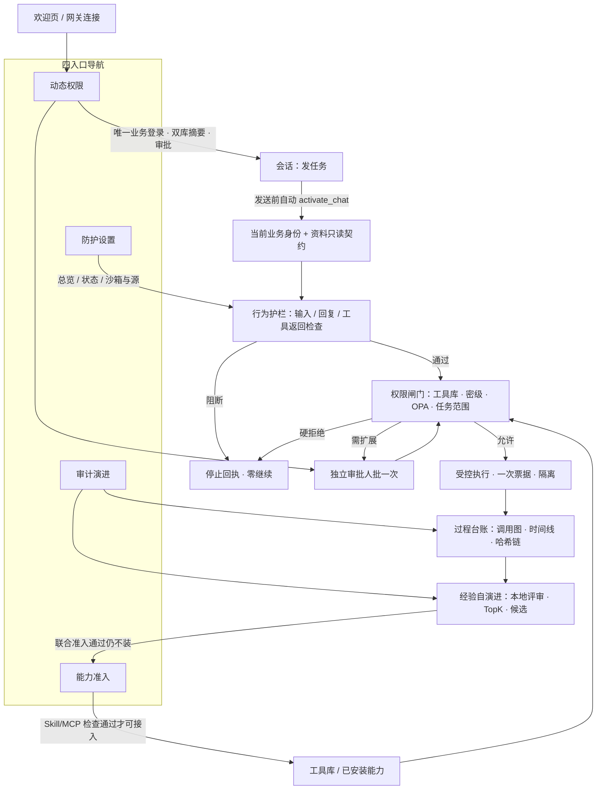

# 政安纵深 · 功能地图

**整理日期**：2026-11-09（Asia/Shanghai）  
**产品壳**：OpenClaw 工作区四入口（`shell.mjs` routes）  
**宿主锁定**：OpenClaw 2026.7.1-2  
**状态口径**：`现网可用`＝当前 UI/服务可日常操作；`演示可用`＝有隔离控制链或历史证据可上台；`设计已定待齐`＝文档已定但端到端/现网尚未齐；`内参边界`＝验收边界，不是产品功能名。

> 面向产品与评委。验收工程话术（Uxx、PASS 表）不进入功能名；详细覆盖与不可扩大解释见 [ACCEPTANCE_BOUNDARIES.md](ACCEPTANCE_BOUNDARIES.md)。

---

## 1. 总览图

四入口环绕**会话执行主路径**；四层政安纵深挂在同一任务上，而不是四套独立产品。

**主故事一句**：谁在办（身份）→ 能用什么（资料库+工具库）→ 危险进不来（护栏）→ 不够可批一次（闸门）→ 做了什么对得上（台账）→ 经验成候选但不自动上线（自演进）。

---

## 2. 四入口功能表

主导航（现网 `shell.mjs`）：**动态权限 / 能力准入 / 审计演进 / 防护设置**。聊天仍是执行入口；无业务委托时其它入口引导回「动态权限」。

### 2.1 动态权限（permissions）

| # | 子功能 | 状态 | 主要角色 | 一句话 |
| --- | --- | --- | --- | --- |
| 1 | 唯一业务账密登录（演示身份源） | 现网可用 | 全体；管理员先开源 | 全产品唯一完整登录表单；JWT 仅进程内委托，刷新需重登 |
| 2 | 当前员工行（级别 / 材料范围 / 审批模式） | 现网可用 | 全体 | 一眼看到权限级别与「演示（非生产）」标识 |
| 3 | 资料库摘要（登记合成资料 × 密级可读性） | 现网可用 | 全体 | 服务端按账号判断可读/不可读，页面不自算 clearance |
| 4 | 工具库摘要（可用 / 无调用权限 / 准入未通过） | 现网可用 | 全体 | 与能力准入同源清单；未知工具默认拒绝 |
| 5 | 待我处理 / 我发起的 / 全部可见审批队列 | 现网可用 | 经办发起；主管审批 | 禁自批；批准≠执行；深链可打开单条申请 |
| 6 | 过期未消费授权「重新申请原动作」 | 现网可用 | 经办 | 新 request 重新核验；旧票墓碑，不重放 |
| 7 | 会话顶栏身份条 +「资料权限」面板 | 现网可用 | 全体 | 任意会话发送前自动套当前身份；取消手动选材作为产品步骤 |
| 8 | 切换 / 退出账号撤销委托与未消费票据 | 现网可用 | 全体 | 另一审批窗不接管发起人会话 |

**兼容**：旧 `home` / `login` / `approvals` 映射到本入口。

### 2.2 能力准入（admission）

| # | 子功能 | 状态 | 主要角色 | 一句话 |
| --- | --- | --- | --- | --- |
| 1 | 同源工具库清单（内置受管 / MCP 声明检查） | 现网可用 | 全体只读；维护可管 | 演示源开启时对受管 MCP 声明做 Aegis 分析，仅 ALLOW 可调 |
| 2 | Skill 上传 / 静态检查 / 适用时动态沙箱试跑 | 现网可用 | 维护 / 管理员 | 有入口才隔离试跑；静态硬拒绝不执行代码 |
| 3 | MCP 配置检查与确认后受控写入 | 现网可用 | 维护 / 管理员 | 配置通过 ≠ 已连接健康；保存走原联合策略 |
| 4 | 准入报告与 ALLOW / BLOCK 回执 | 现网可用 | 维护；演示可演 | 正反回执可对照；合成包演示标「未安装」 |
| 5 | 人工复核登记 | 现网可用 | 维护 | 复核通过＝待重新检查，不改安装资格、不自动安装 |
| 6 | 准入规则编辑（Aegis rules 嵌入） | 现网可用 | 维护（weihu） | 规则只在能力准入改，不在防护设置改 |
| 7 | 已安装技能只读核对（skills 子页） | 现网可用 | 全体只读 | 新能力从准入流程接入，不在此页假装「一键上线」 |
| 8 | Group4 供应链静态补充检查 | 演示可用 | 维护 | 与 Aegis 联合；行为线索检查≠再执行目标代码 |

### 2.3 审计演进（audit）

| # | 子功能 | 状态 | 主要角色 | 一句话 |
| --- | --- | --- | --- | --- |
| 1 | 任务记录列表与筛选 | 现网可用 | 经办 / 审计 | 按任务查看运行；测试轨迹默认可折叠隐藏 |
| 2 | 横向调用关系图（关键过程投影） | 现网可用 | 全体有权读审计 | 输入检查→模型→工具→权限→审批→执行可对上 |
| 3 | 完整毫秒时间线 | 现网可用 | 同上 | 全事件保留；缺字段显示未采集，不补 0 |
| 4 | 哈希链 / 完整性核对 | 现网可用 | 审计 / 维护 | 同一 JSONL 投影；异常就地提示 |
| 5 | 运行对照（compare 子页） | 现网可用 | 审计 | 两次运行对照，不伪造跨 run 因果边 |
| 6 | 本地过程评审（Q / S）与进度 | 现网可用 | 审计；需本地评审后端 | Ollama 或启发式；未生产标定；结果标 test_only |
| 7 | TopK 预览 → 候选生成 → 步骤来源 | 现网可用 | 审计 | 绑定所选轨迹快照；来源不足禁用生成 |
| 8 | 联合准入（候选再检查） | 现网可用 | 审计 / 维护 | admission_passed ≠ 安装 / 发布 |
| 9 | 历史「台风应急简报」六轨迹只读包 | 演示可用 | 评委讲解 | 包内评分与候选可看；禁止在原包上重评生成 |
| 10 | 顶栏「查看过程」抽屉 | 现网可用 | 全体 | 当前任务过程与审批回执同屏 |

### 2.4 防护设置（settings）

| # | 子功能 | 状态 | 主要角色 | 一句话 |
| --- | --- | --- | --- | --- |
| 1 | 安全总览（聚合指标 + 控制路径示意） | 现网可用 | 需业务委托 | 需登录后读本机快照；「需人工审批」是累计策略数不是当前待办 |
| 2 | 实际防护状态卡（输入 / 工具 / 回复 / 身份类型等） | 现网可用 | 同上 | 绿「演示身份」＝已配本机演示身份类型，≠OIDC、≠已登录 |
| 3 | 回复检查状态展示 | 现网可用 | 同上 | 「已启用」可含 observe；观察模式仍只检查记录，本轮未改强制阻断 |
| 4 | 配置与维护：OpenClaw 原生设置入口 | 现网可用 | 网关管理员 | 宿主系统配置仍归 operator.admin |
| 5 | 会话沙箱引擎（Docker 默认 / srt 确认切换） | 现网可用 | 维护（weihu） | srt 切换需确认与耗时提醒；越权切换底层调用为 0 |
| 6 | 演示身份源启停 | 现网可用 | 维护 / 网关管理员 | 源默认关；开启后才可业务登录 |
| 7 | （已收敛）不再放准入规则 / 输入策略菜单于此 | 现网可用 | — | 准入规则归能力准入；避免双入口改策略 |

---

## 3. 运行时主链路

### 3.1 资料库（权威源之一）

| 项 | 说明 | 状态 |
| --- | --- | --- |
| 登记合成资料 | 如应急预案 / 物资 / 值班联系 / 指挥联系 / 受保护资源等，仅 document_id | 现网可用 |
| 密级展示 | 公开 / 内部 / 机密 / 秘密（产品三级展示；后台 secret 仍为高级） | 现网可用 |
| 账号上限 | jingban 公开；shenpi 公开+内部；weihu 全部登记合成资料 | 现网可用 |
| 自动只读契约 | 会话发送前按 OPA×registry 建可读契约；前端/模型不交材料列表 | 现网可用 |
| 越密级 | 硬拒绝，**不能**用审批抬高 clearance；零读取可核对 | 现网可用 / 演示可用 |
| 生产文件纳管 | 未做 | 内参边界 |

### 3.2 工具库（权威源之二）

| 项 | 说明 | 状态 |
| --- | --- | --- |
| 受管适配器目录 | 页面与聊天前置闸门消费同一目录 | 现网可用 |
| 内置受管原生工具 | read/write/edit/exec 等标内置受管，不冒称外部 MCP 准入 | 现网可用 |
| MCP 声明检查 | 演示源启动时本地 Aegis 静态声明分析；非 ALLOW / 未知 / 无权 → 阻断 | 现网可用 |
| 原因码 | 未知 P024、角色无权 P025、准入未通过 P026 等 | 现网可用 |
| 外部组件完整安装扫描 | 声明检查不替代 | 内参边界 |
| UI JWT 与独立 MCP 进程身份贯通 | 仍有 P006 类衔接缺口 | 设计已定待齐 |

### 3.3 会话自动身份

| 项 | 说明 | 状态 |
| --- | --- | --- |
| chat.send 前 activate_chat | 自动套当前委托；无委托/过期/切换中拒绝 | 现网可用 |
| 取消产品级手动绑定选材 | 以 [AUTOMATIC_CHAT_IDENTITY](AUTOMATIC_CHAT_IDENTITY.md) 为准 | 现网可用 |
| 旧 bind/select 接口 | 仅内部回归兼容 | 内参边界 |

### 3.4 行为护栏（输入 / 回复 / 工具返回）

| 项 | 说明 | 状态 |
| --- | --- | --- |
| 选定注入攻击停止 | 模型/工具前停止，可核对 stop 回执与零继续 | 演示可用（现网链路可复现） |
| 回复 / 工具返回检查 | 有检查与记录；流式完整前门控等勿扩大宣传 | 现网可用（observe 边界见验收） |
| 全攻击覆盖 / 普遍零误报 | 不支持 | 内参边界 |

### 3.5 审批与一次票

| 项 | 说明 | 状态 |
| --- | --- | --- |
| 任务范围不足可申请一次 | 不改变永久权限；申请人/原范围/目标齐全 | 现网可用 |
| 禁自批 | jingban / shenpi 成立 | 现网可用 |
| 批准后原动作重试 · 再请求拒绝 | 批准≠已读；票一次消费 | 现网可用 / 演示可用 |
| TTL / HMAC 核销 / 墓碑 | 短时委托与票据 | 现网可用 |
| weihu native-only | 免另一人业务审批，保留 OpenClaw 原生确认；不绕过 OPA deny | 现网可用 |

### 3.6 沙箱双引擎与其它执行隔离

| 项 | 说明 | 状态 |
| --- | --- | --- |
| 会话 Docker（默认） | 会话执行隔离插件 | 现网可用 |
| srt | 可切换，需确认 | 演示可用 |
| Aegis 安装前动态沙箱 | 有代码入口时试跑 | 现网可用 |
| AgentGuard MCP 授权 / OPA 三态 | 允许 / 审批 / 拒绝 | 现网可用 |

---

## 4. 后台 / 模块能力映射

产品名优先，括号为仓库模块。

| 产品能力（四层） | 用户感知入口 | 主要模块 | 状态 |
| --- | --- | --- | --- |
| **行为护栏** | 会话阻断回执；防护设置状态卡 | `protect-agent-group1`（输入/输出/工具返回检查链）；AgentGuard 钩子协同 | 现网可用 / 选定攻击演示可用 |
| **权限闸门** | 动态权限；会话自动身份；审批 | `agentguard-group2`（identity / enforcement / approval / policy OPA / tools） | 现网可用 |
| **组件准入** | 能力准入 | `aegis`；`supply-chain-group4`；UI 嵌入 Aegis 面板 | 现网可用 |
| **过程台账** | 审计演进；查看过程 | `govagentsec-trace`（采集、图、时间线、哈希）；native-approval 投影 | 现网可用 |
| **经验自演进** | 审计演进候选区 | `govagentsec-trace` + `trajectory-governance`（LocalJudge、Workshop、联合准入、发布门禁） | 现网可用（候选）；发布到生产未开 |
| **会话执行隔离** | 防护设置 | `session-sandbox` | 现网可用 |
| **工作区壳与视觉** | 四入口 / 欢迎页 | `govagentsec-ui` | 现网可用 |
| **模型路由** | 后台 | `model-routing` | 现网可用（配置层） |
| **逐次 API 用量包装** | 审计注解（可选） | `govagentsec-usage-wrapper` | 默认关闭；启用另验 |
| **网关运行时防护插件（Group4-01）** | 供应链侧 | `supply-chain-group4/01-...` | 演示 / 集成证据视部署 |
| **组织 OIDC** | — | identity 内 Keycloak 等设计 | 未接入现网业务登录 |

---

## 5. 演示账号与权限矩阵摘要

全部为**演示非生产**。口令仅场前核对，台上不念明文（见 U25 矩阵）。

| 账号 | clearance / 级别 | 资料可读上限 | 审批 | 规则 / 沙箱 |
| --- | --- | --- | --- | --- |
| `jingban` 经办 | 0 | 公开 | 发起；禁自批 | 否 |
| `shenpi` 主管 | 1 | 公开、内部 | 可批他人；禁自批 | 否 |
| `weihu` 管理员 | 3 | 全部登记合成资料 | 本人 native-only；可批他人 | 是 / 是 |
| `shenji` 只读审计 | 审计岗（非第四执行级） | 无业务文件执行 | 不可审批 | 否（可评轨迹） |

资料矩阵（身份上限；普通账号仍受任务/票据约束）：

| 资料密级倾向 | jingban | shenpi | weihu |
| --- | --- | --- | --- |
| 公开 | 允许 | 允许 | 允许 |
| 内部 | 拒绝 | 允许 | 允许 |
| 机密 / 秘密 / 受保护 | 拒绝 | 拒绝* | 允许 |

\*中级不可读机密/秘密；审批他人申请**不**等于自己获得读取权。

---

## 6. 边界与非目标（不是产品功能）

下列内容**不要**讲成「已上线功能」：

| 边界 | 说明 |
| --- | --- |
| 演示身份 ≠ 组织 OIDC | 本机演示 JWT；生产 SSO 未接入 |
| 候选 ≠ 安装 / 发布 | 联合准入通过仍不装；test_only 不可生产复核 |
| 轨迹与本地安全评审默认不出域 | 聊天模型是否外发以实际会话配置为准，须单独告知 |
| 合成资料 ≠ 生产文件权限 | registry 演示库 |
| 声明检查 ≠ 下游身份已委托 | UI 身份与独立 MCP `loopback_static_dev` 未完全贯通 |
| 观察模式 ≠ 已改强制阻断 | 回复检查「已启用」文案不改变后端 observe |
| 控制链 / 历史证据 ≠ 本场连续业务 run | 讲解须标注画面来源 |
| 完整自然语言办公产物 | 本地通用模型端到端简报仍有缺口（如 P006） | 设计已定待齐 |
| U20 用量包装 | 默认关 |
| 验收 Uxx / PASS 表 | 只进边界文档与证据盘，不进业务功能名 |

---

## 7. 与旧五入口对照

| 旧导航（U24 期） | 新四入口 | 说明 |
| --- | --- | --- |
| 任务 | **动态权限** + 会话 | 登录、双库、审批归动态权限；执行在聊天；手动选材步骤已取消 |
| 待审批 | **动态权限**（兼容 approvals） | 待我处理 / 我发起 |
| 能力库 | **能力准入** | 工具库 + Skill/MCP + 规则；skills 为子页 |
| 审计与改进 | **审计演进** | 图 / 时间线 / 评审 / 候选；compare 为子页 |
| 防护设置（底部） | **防护设置** | 总览 → 实际状态 → 配置与维护（OpenClaw+沙箱） |

旧深链：`home`/`login`/`approvals` → permissions；`compare` → audit 子页；`skills` → admission 子页。

---

## 8. 相关文档索引

| 文档 | 用途 |
| --- | --- |
| [U25_FOUR_ENTRY_WORKSPACE_IA.md](U25_FOUR_ENTRY_WORKSPACE_IA.md) | 四入口 IA |
| [U26_DUAL_LIBRARY_RUNTIME_GATE.md](U26_DUAL_LIBRARY_RUNTIME_GATE.md) | 双库闸门 |
| [AUTOMATIC_CHAT_IDENTITY.md](AUTOMATIC_CHAT_IDENTITY.md) | 会话自动身份（最新操作路径） |
| [ADMIN_NATIVE_APPROVAL.md](ADMIN_NATIVE_APPROVAL.md) | weihu native-only |
| [ACCEPTANCE_BOUNDARIES.md](ACCEPTANCE_BOUNDARIES.md) | 验收边界 |
| [JUDGE_DEMO_PLAN_FOUR_ENTRY.md](JUDGE_DEMO_PLAN_FOUR_ENTRY.md) | 评委 8 分钟方案 |
| [PRODUCT_DEMO_RUNBOOK.md](PRODUCT_DEMO_RUNBOOK.md) | 旧导航口径操作手册（对照用） |
| [产品使用逻辑与模块协同.md](产品使用逻辑与模块协同.md) | 模块协同（部分导航表述早于四入口，以本图与 U25 为准） |

---

*本文件仅文档交付；未改产品业务代码、未改 openclaw.json、未 push。*
