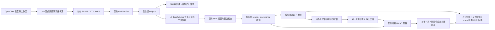

# U10 业务身份与任务最小权限设计

> 文档状态（2026-11-10）：历史记录：保留当时的设计、界面或验收结论，不代表当前操作流程。当前行为见[系统基准](CURRENT_SYSTEM.md)。

阶段 A：已完成材料核对与自检；产品实现从本文完成后开始。OpenClaw 固定 2026.7.1-2。

## 1. 架构与边界

网关登录 ≠ 业务身份。当前组织 OIDC 未接；演示选人不构成真人认证，MFA 为合成声明。复用生产校验内核，但不宣称生产身份完成。Aegis 是能力准入；U9 是会话执行隔离；本包任务 ACL 是受管工具执行前权限检查，三者不混称。

## 2. L1 / L2 数据流

- U4b 进程内 JWKS，固定演示 issuer；不启动外部 IdP、不降级生产 HTTPS 要求。JWT 含 sub、iss、aud、iat、exp、department、clearance、realm_access.roles、amr、azp、scope。Verifier 验签后形成 subject，拒绝 body 角色与网关 token。
- Bearer 仅 UI 闭包和私有 stdio 内存；300 秒或激活到期即失效；演示激活 900 秒，关闭销毁签名密钥与运行态。默认关闭，执行与审批默认不可用。
- 创建任务：服务端生成 task_id；用户明确选择目录 A/B 与 file.read 工具。目录为受控文档 registry 的逻辑 URI 树，A=`govdoc://demo/public/`，B=`govdoc://demo/internal/`，不接受任意 Windows 路径。
- U7 契约保存 allowed_tools、resource_prefixes、revision、subject_id、用户参数哈希、有效期。URI 必须规范化且按目录边界匹配；空目录集表示禁止所有文件。旧契约未声明目录时沿用 U7 现有行为，不扩大权限。
- 读取使用 registry 构造 action；执行前校验 OPA、目录、工具、provenance。任务外文档不列为可用；专用越界演示按钮明确标「未授权」。拒绝不调用底层 reader。
- 越界请求先 DENY；经办点击申请后，仅为服务端保存的原 task/action 摘要登记待批快照。审批复用 resolve_approval_authenticated，另一 business_approver 确认；不得越过 OPA 硬拒绝。
- 同一契约运行中只能收紧工具/目录；revision 改变清空待批与扩权。审批授权 60 秒、执行票据 30 秒；票据绑定 task、subject、action_digest、revision、scope_digest；只执行原动作一次，不修改基础目录/工具集。票据与凭证不返回浏览器。

## 3. 接线表

| 文件/模块 | 职责与本包动作 |
| --- | --- |
| identity/oidc.py、approver.py | 复用验签/claims/审批角色边界，不改验证算法 |
| identity/keycloak/agentguard-realm.json | 扩展 auditor-test 合成只读角色；U4b 仍复用此用户表 |
| identity/demo_provider.py | 扩展任务创建、读取、显式扩权申请和脱敏台账；沿用同一演示源 |
| enforcement/task_policy.py | 扩展 U7 契约目录、单调收紧、显式扩权快照与 scope digest |
| service/app.py | 扩展可信任务入口，沿用 invoke / resolve / 禁自批 |
| enforcement/gateway.py、tickets.py、documents.py | 复用 OPA→票据→适配器；必要审计字段补齐；不另造闸门 |
| runtime plugin/demo-identity.mjs | 扩展既有鉴权 RPC，严格参数白名单 |
| govagentsec-ui/demo-identity.mjs | 扩展同一入口与审批队列、任务范围和只读审计视图 |
| Protect tool-surface、session-sandbox | 复用并保持不变；不宣称所有原生工具都受任务 ACL 管理 |
| scripts/test_identity_task_acl.py、test_task_acl_live.mjs、verify_identity_task_acl.mjs | 新增专项、真实页面与一键证据 |

## 4. UI 文字草图

现有「演示身份源」卡：固定非生产徽章 → 开启/关闭 → 经办/财务/处长/审计选人 → 当前已验证身份。
下方「任务最小权限」：目录选择 A/B、工具固定 file.read → 创建任务 → task_id、允许目录和工具、scope digest → 当前可用文档的读取按钮。
另有明确标未授权的「尝试读取目录 B」按钮；DENY 回执后显示「申请一次性扩权」。原审批队列展示文档 ID、目录差异、原因码、scope digest、TTL；处长点击「人工确认并执行」。
「过程台账」折叠区显示脱敏身份/任务/审批/执行记录；审计身份仅能查看，不能创建、读取或审批。不能把审计角色的只读状态当作登录失效。

## 5. 角色矩阵

| 角色 | 演示用户 | 可发起 | 可审批他人 | 可自批 | 默认文件/工具 |
| --- | --- | --- | --- | --- | --- |
| 经办 | office-test | 是 | 否 | 否 | 任务范围内 file.read；其他动作沿用 OPA |
| 财务 | finance-test | 现有付款 | 否 | 否 | 沿用财务 OPA，非文件权限 |
| 处长 | approver-test | 仅策略许可 | 是 | 否 | 审批原经办动作，不能借审批取得经办权限 |
| 审计 | auditor-test | 否 | 否 | 否 | 只读脱敏台账，不授予业务执行工具 |

## 6. 失败与审计

无身份/坏签名/网关 token→401；未开启→默认关闭；角色伪造→403；审计执行→403；目录越界 P014、工具越界 P015；非法 URI、静默扩权、过期契约拒绝；自批 D105；OPA/票据/适配器故障 fail-closed。原 D004/D005 不可通过任务扩权绕过。
审计保留 identity_source=demo_idp_verified_jwt、task_id、subject_id、scope_digest、document_id、reason_code、审批人/审批状态与安全 receipt_id、执行次数；不保存正文、Bearer、HMAC 票据或私钥。拒绝和审批均有台账，范围改变使旧票据失效。

## 7. 五步演示

1. 开演示源，经办登录，徽章标非生产。
2. 创建只绑定目录 A / file.read 的任务，读取 A 成功；可用列表不含 B。
3. 显式尝试 B，DENY、读取次数不增；经办申请原动作的一次性扩权，自批拒绝。
4. 处长登录，在原审批队列批准；同一任务 B 仅执行一次，基础范围仍 A；重放拒绝。
5. 审计身份查看台账；关闭演示源，恢复默认禁用，配置哈希不变。

## 8. 切片与风险

1. 扩展 U4b 审计身份与徽章；2. 角色边界专项；3. U7 目录/工具约束；4. 原审批/票据一次性扩权；5. 回归、真实 UI 截图、JSON 与恢复检查。
Windows 物理文件仍只由现有隔离 registry reader 接入，本包逻辑目录不代表全盘 ACL。演示 issuer 不是可访问 HTTPS 组织端点；组织认证和逐聊天 run 自动绑定仍不在本轮交付范围。现有 U7 PARTIAL 的未全量受管工具缺口不冒称修复。
非目标：真实 IdP/组织密钥、重做 U9、假大屏、完整 CaMeL、所有原生工具强制接入。

## 阶段 A 自检（产品代码修改前）

- [x] 文档位于 docs/IDENTITY_TASK_ACL_DESIGN.md 工作区。
- [x] L1 明确扩展 U4b，无第二套身份。
- [x] L2 明确扩展 U7 契约与现有 AgentGuard 票据，无第二套闸门。
- [x] UI 诚实口径固定；网关登录 ≠ 业务身份。
- [x] 无单位 IdP 可完成五步演示。
- [x] 非目标已明确，不扩大到 U9 或生产组织接入。

## 全量覆盖（U11）

前置 U7b 已 PASS，2026-11-08 再跑 `node scripts/check_notify_tools_live.mjs` 退出 0。固定宿主 2026.7.1-2 的 `hook-types-DQ9eTy2x.d.ts` 已核对：before_agent_run.prompt 是当前用户消息；runId/sessionKey/workspaceDir 来自宿主 context，before_tool_call 可返回 block/blockReason。

### 聊天绑定与授权

使用原演示源登录后，用户显式将业务身份绑定到会话 key；该操作只绑定身份，不能传角色、工具或 scope。新 user turn 的 before_agent_run 创建 run 独立 task_id。只从当前用户消息提取明确的 `/workspace/目录/文件`，不从历史、模型参数或工具输出扩权；初始只读模板，默认没有文件范围。公开预案关键词只授予 registry 中公开预案的读取。附件尚无可信映射时不自动授权，必须走明确路径或审批。原手工面板保留用于调试。

Bearer 仅在私有 worker 内存绑定，关闭/过期立即失效。模型不能调用内部 chat_start/chat_tool 操作；这些只由插件经私有 stdio 传入。会话换身份撤销旧绑定及待用授权。没有 runId、workspace 或已验证身份，不推测最近任务。

| 类别 | 宿主工具实名 | ACL 动作与范围 | 无 scope |
| --- | --- | --- | --- |
| 读 | read | native.read；规范化 workspace URI + 用户路径哈希 | DENY |
| 写 | write、edit | file.write；路径范围 + 完整参数哈希；现有角色/审批约束 | DENY |
| 批量修改 | apply_patch | 默认 DENY，未支持严格全路径解析不放行 | DENY |
| 执行 | exec、process | shell.execute；完整命令/参数 provenance，现有 OPA 角色/沙箱约束；process 默认拒绝 | DENY |
| 网络 | web_fetch、web_search、browser | 默认拒绝；不能用审批解除 U9 断网 | DENY |
| 受管 MCP | agentguard-notices__read_gov_document、list_notices、request_test_payment、run_protected_command、submit_emergency_notice、get_control_request_status | 同一运行 TaskPolicies 先检查，再经过原 MCP 网关；未知映射拒绝 | DENY |
| 其他工具 | 未登记工具/别名/委派执行 | 默认拒绝，防止间接执行绕过 | DENY |

选择 **A：硬 DENY**。原生路径只允许当前 U9 workspace 内规范路径；拒绝 ..、绝对宿主路径及符号链接逃逸，不枚举无关文件。最小模板只授予 native.read/file.read/database.query；写/执行受既有角色限制，任务审批不能覆盖 OPA 硬拒绝。

### 复用内核与审批

扩展同一 TaskPolicies 的 workspace URI，不引入新策略引擎。继续 OPA → action_digest → scope/provenance → HMAC 票据。新增宿主执行模式仅对私有 worker 的服务端请求启用：票据核销后交回 OpenClaw/U9 执行，不把“已授权”写成“已执行”。after_tool_call 单独记录宿主结果。MCP 保留原网关二次检查，不替换其 request_id/task_id；运行 ACL 的 task_id 在独立审计中关联 runId。

越权先拒绝并保存原动作；经办在原面板显式申请，再由另一 business_approver 批准，复用 resolve_approval_authenticated、TaskPolicies.approve 和原一次性票据。批准不直接读取文件；原会话、原主体在 30 秒内重试完全相同动作时消费授权。即使新 turn 创建新 scope，获批重试仍使用服务端保存的原 task/action；基础范围不会扩大。变更参数、换会话/身份、过期、重复消费均拒绝；关闭演示源撤销全部内存授权。

审计只保存任务/run 关联、scope_digest、identity_source、工具与参数哈希、原因码、授权/执行状态；不写正文、Bearer、票据。U9 管隔离，Protect 管输入/返回和停机，Aegis 管准入，本包只管任务权限。非目标：组织 IdP、完整 CaMeL、全盘 OS ACL、恶意代码完全隔离、重做双沙箱。

### 阶段 A 自检（U11，产品修改前）

- [x] 全量覆盖一节已写入设计文档。
- [x] 聊天自动绑 scope 的触发点与数据流已写清。
- [x] 原生工具覆盖表已按仓库实名填写。
- [x] 无 scope 选 A，敏感工具默认拒绝。
- [x] 明确复用 U10 审批、ticket、禁自批、防重放。
- [x] U7b 已完成并重新检查通过。
