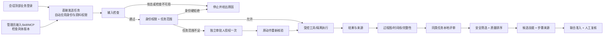

# 产品使用逻辑与可执行改版方案

**2026-11-09 最新调整**：用户取消手动绑定和选材。当前实现以 [会话自动身份与资料权限](AUTOMATIC_CHAT_IDENTITY.md) 为准：在会话顶部登录/切换账号，所有对话发送前自动应用该身份，资料由服务端权限判断。下文保留的选材草图属于历史设计，不再作为产品操作步骤。

2026-11-09。本文件保留11月8日体验评审后的目标设计。用户随后授权开发，欢迎入口、选材、审批恢复、自动过程图与本地评审已按切片实现，实际结果以[U24实施记录](U24_PRODUCT_FLOW_IMPLEMENTATION.md)为准；下列目标布局和未完成项不应整体视为已交付。问题原始证据见[JUDGE_USER_FULL_CRITIQUE](JUDGE_USER_FULL_CRITIQUE.md)。

## 1. 产品的组织单位：一次任务

用户先完成事情，再按需看安全过程。四层能力围绕同一任务连接：



图中“工具/隔离”并不表示所有工具均运行于Docker：原生工具隔离与受管MCP适配器是各自现有执行链。候选复核结束不画成自动生产安装。

标识各司其职：现有策略task_id连接权限契约，且新运行可能产生新task_id；runId/trace_id连接一次运行事件；task_key连接经用户确认的同类历史任务。UI的业务任务通过可信会话绑定、request_id和origin_run_id关联多个既有契约/运行，不把策略task_id重写成统一ID。不能靠同名标题或时间邻近制造关联。

## 2. 角色与导航

| 角色 | 默认落点 | 主操作 | 隐藏到管理/详情 |
|---|---|---|---|
| 经办 | 我的任务/继续当前任务 | 发起任务、查看资料权限与结果、申请范围扩展 | MCP配置JSON、策略阈值、引擎切换 |
| 审批人 | 待我处理 | 核对动作/原范围/申请范围、批准或拒绝 | 聊天设置、扫描器日志 |
| 安全管理员 | 能力与策略 | Skill/MCP检查、具体版本准入、执行环境状态 | 常规经办对话 |
| 审计/技能管理员 | 审计与改进 | 过程核对、同任务评审、候选复核 | 密钥与网关连接配置 |

角色从服务端可信身份获取。导航隐藏只是简化展示，不能代替接口授权。当前业务演示角色和候选设备管理员权限不同，先明确显示所需角色；不能通过改徽标将它们合并。

左侧主导航收敛为：**任务、待审批、能力库、审计与改进**。设置放底部管理员入口。顶部只保留当前任务、身份、一个“查看过程”。历史轨迹归审计页；保留旧深链重定向，不保留三套同名常驻入口。

## 3. 登录与首次进入

普通入口是一张中文业务登录页：产品名、环境、角色/已配置登录方式、主按钮。默认演示环境明确标“演示身份（非生产）”，不显示假的组织用户名密码框。管理员先开启演示源，用户不负责猜网关令牌。

需解决真实技术条件：现在无网关认证时插件工作区尚未加载，不能假设把业务登录组件挪到首页就能替换宿主登录墙。先验证固定宿主支持的入口/语言能力；必要时加仓库内独立loopback欢迎页，只有品牌、中文连接帮助和进入已认证工作区的入口，不暴露受保护API、不把网关secret写静态文件、不依赖patch内核。此页必须实测可达后才算R01完成。

网关连接与业务登录保持安全分工，管理员走“连接工作区”，用户在已接入设备上登录业务身份。无合法网关凭证不能跳过认证。网关密码与业务身份密码不混用。

刷新后业务委托丢失是当前设计；改版应保留可读任务位置，提示“请重新登录以继续”，登录后重新向服务端核对原绑定。不把Bearer存入localStorage，不自动恢复已过期或已撤销权限。

## 4. 任务页面

以下为布局草图，非已实现截图：

```text
任务 / 台风应急简报                         经办：演示用户   查看过程
─────────────────────────────────────────────────────────────
材料  公开预案、物资清单       允许  只读       输出  带来源的简报
能力  受控文档服务             执行环境  Docker已就绪
─────────────────────────────────────────────────────────────
本次结果 / 进行中的对话                         当前动作
                                              读取公开预案
                                              已检查 → 执行中
                                              [查看依据]

需要新增材料时，在同一位置出现：
“物资补充表不在本任务范围，尚未读取”             [申请一次读取]
─────────────────────────────────────────────────────────────
输入任务补充要求…                              [发送]
```

新建任务依次选：业务模板、可见材料、期望产物。模板只预填建议，不能给权限。材料来自服务端registry/当前已授权工作区枚举；浏览器只提交材料ID，服务端解析路径、密级、资源和允许动作，沿用U10/U11核验。模型不得扩大范围。

发送前展示三项摘要：“用哪些材料”“允许做什么”“在哪里处理”。默认只读；需要写文件/运行脚本的模板必须先完成对应角色和沙箱链验收，不能把已有只读案例包装为完整办公生成。

当前路径正则继续作为兼容入口；新显式材料确认优先，二者冲突时要求重新确认。多个材料无效或无权访问时逐项指出，不自动降为广目录授权。

## 5. 状态与审批

| 真实状态 | 用户文案 | 主操作 |
|---|---|---|
| 检查中 | 正在检查本次请求 | 等待；保留取消 |
| 检查不可用 | 安全检查暂不可用，本次未执行 | 重试检查/联系管理员 |
| 输入注入阻断 | 检测到越权指令，本次已停止 | 修改请求；查看原因 |
| 身份密级/保护资源硬拒绝 | 当前身份无权读取这份材料 | 选择其他材料；不提供绕过审批 |
| 任务范围不足 | 这份材料不在本任务范围，尚未读取 | 申请一次读取 |
| 待审批 | 等待审批人处理 | 查看申请；继续其他允许动作 |
| 已批准 | 已授权原动作一次，等待重试 | 返回原任务；显示有效倒计时 |
| 执行中 | 正在读取已批准材料 | 等回执；按钮防重复 |
| 执行成功 | 已读取，单次授权已使用 | 查看结果与来源 |
| 过期/结果未知 | 授权已过期 / 暂未收到执行回执 | 重新申请 / 核对状态，不能直接重放 |

请求卡展示申请人、具体动作、材料名/密级、原任务范围、新增范围、原因、审批人和时效。摘要/digest/票据不进首屏，秘密票据永不展示。D004/D005与可扩展任务范围区别来自服务端原因码，不由前端猜测。

审批页默认“待我处理”，以可见范围为准；经办不能自批。双人演示用独立标签页，换身份不共享委托。

近期仍沿用“返回原任务，重试原动作”。只有后端具备绑定原动作快照的精确重试接口时，才能提供“执行已批准动作”；不能用自动补一句自然语言冒充精确恢复。当前过期旧申请没有直接重新申请入口，失效/消费记录仍保留；改版需提供创建新request、重新核验动作的恢复路径，保留旧票据墓碑，不延长TTL、不重签已消费票据。这需要复用现有内核补接口，不能只加按钮。

## 6. 过程与审计

任务内默认业务关键链：“输入检查→模型调用→受控读取→权限拒绝→申请→批准→授权重试→结果”。这是已有事件的投影；每个聚合节点能展开其真实事件，不补造模型计划、Skill使用或审批节点。

图默认适应可视宽，5–8个关键节点；长链按阶段折叠。完整毫秒时间线保留全部事件。点击节点首先显示动作、对象、耗时、判定和结果，再展开原始JSON/证据hash。BLOCK/ALLOW同时用文字、图标和颜色，不能只靠红绿。

当前运行可见时按约1–2秒刷新所选trace，后续再根据规模决定订阅；隐藏页暂停，完成后停止高频更新。不跳选中trace、不重置用户滚动/展开项。断线显示最后更新时间，不能沿用“实时”绿灯。原运行结束后的审批与新运行执行以任务聚合，并保留两个run及可信origin关联。

历史页默认业务任务组＋可读名称。合成测试、旧版记录、校验异常分别筛选；保留数据不删除。全局采集失败汇总可折叠，但影响当前记录时必须就地提示。缺字段显示“未采集”，不写0。

## 7. 同类任务到候选

流程：选择已确认任务组 → 本地评估 → 看安全隔离与Q缺失 → 预览TopK → 生成候选 → 联合准入 → 人工复核。不会直接安装。

评估只使用现有Ollama/启发式LocalJudge与scoring契约；进度显示总数、已评、隔离、失败和实际评审来源。正常样本同分不是错误；不扰动分数制造“区分度”。业务质量未验证时写“过程评分”，业务结果质量另用材料引用、事实一致性、格式和留出任务量规证明。

生成前必须呈现实际参与集合，明确“本任务全部运行”或“仅所选”；对比所选不应暗中生成全集。显示安全集合分母（含缺Q）、keep、floor结果和最终可选数。keep=.9且仅2条safe时预计选1，应提示补足来源，不能靠改公式通过。

候选页面只优先显示：用途、公共步骤、需要人工补全的信息、每步来源、准入结果、下一步。公共工具序列尚未证明参数约束/恢复策略已学会；留出任务未验证时不能声称可直接生产使用。

历史6条真实轨迹的证据包提供只读打开方式，注明时间与来源。不得悄悄复制进现网工坊并伪称本轮生成；导入候选必须显式操作、重新核验完整性并进入独立候选区。

## 8. 能力库与沙箱

每项能力显示四个独立状态：配置/连接、准入版本与时间、当前任务授权、最近执行结果。缺准入回执写“尚无检查记录”，不得把eligible或enabled翻译成安全通过。

普通用户选择已批准能力。管理员走“选择模板/上传→检查→查看结论→确认接入”。MCP检查通过后保存配置和连接验证分开；连接验证尚未做就显示待验证。Skill结果按实际分“语义场景检查”与“代码隔离试运行”。静态拒绝不执行代码。

任务页环境只显示准备中/就绪/失败和实际引擎。引擎切换进管理员设置，保留srt切换前的耗时/到期提醒。冷启动失败保持停止，不回退宿主。

## 9. 复用接口与必要补齐

下表新增名称为设计建议，编码前确认现有类型与权限；不是宣称已有API。

| 页面行为 | 已有实现 | 最小补齐 |
|---|---|---|
| 业务登录/状态 | identity-session；demoIdentity.status/login/revoke；页内委托 | 登录后回原任务；管理员启停入口归位 |
| 当前会话绑定 | task-context；demoIdentity.bind_session | 显式材料范围预览/确认，复用ChatAcl和U10任务策略；服务端解析材料ID |
| 审批/返回 | task_escalate、resolve；gov-return-task | 统一状态卡；到期后以新request重新申请并复核，保留旧墓碑；不新增审批内核 |
| 任务过程 | trace.health/list/detail；native-approval投影；traceGraph | 可见所选运行刷新、关键节点投影、任务聚合 |
| 评审 | CLI assess→LocalJudge→scoring.assess | 受鉴权本地作业入口与作业状态；固定允许的judge配置，不接受外部URL/任意命令 |
| 生成/准入 | trace.generate/admit/releaseGate/confirmReview | 确定参与集合/证据版本、数量预览；保持原安全门槛 |
| 能力接入 | govagentsec.ui.open；Aegis现有上传/检查；combined策略 | 回执与版本映射、实际健康、成功后返回原任务 |
| 历史证据 | TraceStore/read/verify及离线渲染 | 只读证据包入口，服务端限定目录，不接受任意磁盘路径 |

评分作业不要把浏览器断开等同失败或成功；作业ID仅查状态，结果仍追加原链。取消停止未开始的项，已完成项保留。前端只消费原判定，不重算权限或私自放行。

## 10. 分片开发与验收

| 切片 | 主要文件/职责 | 完成条件 |
|---|---|---|
| A 入口与任务 | shell/workspace、identity-session、task-context；必要任务范围接口 | 新浏览器中文入口；业务登录后能选材料并确认范围；不填key/path；两身份不同可见权限；无token仍受保护 |
| B 审批主线 | demo-identity、当前任务状态卡；复用ChatAcl | 范围拒绝读取0；禁自批；批准不等于执行；原动作只成功一次；过期、改参、重复均拒绝；返回不丢任务 |
| C 过程展示 | trace/view、view-model、shell | 新事件无需手动刷新；18节点真实样例首屏见关键节点；缩窄/展开不丢选中；审批跨run不伪造边；完整时间线数量不变 |
| D 评审候选 | register/现有assess作业包装、对比和候选页 | UI独立完成本地评审→预览→生成→准入；2safe的数量提示正确；集合与证据一致；毒候选拒绝；无安装请求 |
| E 准入与文案 | Aegis页面、workspace能力卡 | 健康不写死；配置/准入/连接分列；成功回任务；产品默认无验收长文；关键限制仍可见 |
| F 连续业务排练 | 现有验证脚本与演示材料 | 同一场景连续两次完成；真实简报结果可核对；记录每步耗时/点击/失败；全程无临时CLI修补 |

先完成A/B/C，再D/E；F贯穿并作最终交付门槛。无需重做U4b/U10/U11、OPA、HMAC或双沙箱。

视觉规格建议：复用青绿主色，白/浅灰背景；常规正文14–16px，辅助至少12px；单一主要动作、边框分组、减少大空卡；状态色配文本；不增加发布会网站式hero、轮播、装饰动画。1440×900首屏能看任务/范围/当前动作和结果入口。键盘可到所有主操作；抽屉关闭回原焦点；异步状态aria-live；iframe有标题和返回路径。

## 11. 文案分工

产品说当前事实和下一步；[ACCEPTANCE_BOUNDARIES](ACCEPTANCE_BOUNDARIES.md)解释覆盖与验收。保留“演示身份”“历史记录”“候选未安装”“证据不足”“服务不可用”“可能由外部会话模型处理”等决策信息。Uxx、PASS计数、论文复现差距、JSONL算法、Windows Alpha机制、内部文件路径移出默认页面。
