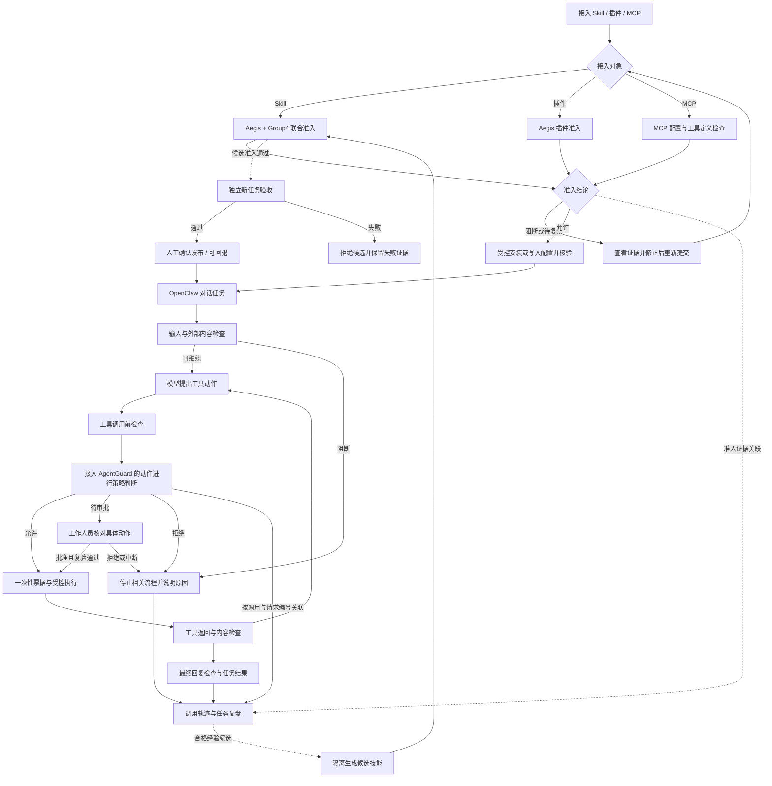

# GovAgentSec 产品使用逻辑与模块协同

更新日期：2026-11-04。依据当前代码、本机插件配置与任务工作台集成验证整理。任务工作台已上线，剩余能力以文中边界为准。

## 1. 产品主线

**先审核要接入的能力，再控制每一次执行，最后沿着证据复盘任务；合格经验经过验证后，才能成为下一版技能。**

用户的主要工作发生在 OpenClaw 对话中。安全模块围绕任务提供检查、审批和追溯，不要求普通用户在四个技术模块之间反复切换。

| 环节 | 用户要解决的问题 | 产品入口 | 主要支撑模块 | 交付结果 |
| --- | --- | --- | --- | --- |
| 使用前 | 这个 Skill 能否安装？这个 MCP 服务能否接入？ | 准入中心 | Aegis、Group4 | 准入结论、风险证据、已核验的安装或配置结果 |
| 使用中 | 这段内容能否信任？这个动作能否执行？ | 对话工作台、运行防护、待审批 | 输入防护链、AgentGuard、OpenClaw | 放行、待审批或阻断，以及实际执行回执 |
| 使用后 | 做了什么？为什么这样处理？是否完成任务？ | 审计中心、对话内历史轨迹 | 轨迹治理、AgentGuard 审计、Aegis 报告 | 调用图、事件详情、决策依据、业务结果 |
| 持续改进 | 哪些经验可以沉淀？新技能是否更可靠？ | 审计中心下的技能改进 | 轨迹评审、SkillClaw、联合准入、独立验收 | 隔离候选、验证结果、人工确认后的版本 |

管理导航已按“准入中心、运行防护、审计中心”组织，内部复用 Aegis、AgentGuard 等现有页面。日常操作优先使用聊天内“任务与轨迹”侧栏。

## 2. 总体流程图

下图表达应当形成的用户流程；虚线表示当前尚未完整自动打通的关联或反馈。



输入防护与 AgentGuard 在图中按业务理解顺序展开，不代表当前所有工具都经过同一个串行网关。接入覆盖范围必须以实际工具路径和钩子授权为准。

## 3. 使用前：把能力接入变成可检查的准入流程

### 3.1 首次准备与日常就绪检查

管理员先确认 OpenClaw 网关、必要插件、本地检测模型、AgentGuard/OPA 以及适用的 Docker 环境可用，再开放对应功能。

建议在统一工作台显示功能级状态：“可用”“未启用”“服务离线”“等待模型”“仅演示”。不要用“页面能打开”代替“防护能执行”。例如，输入防护服务在线与宿主允许其读取对话是两件事。

普通用户不需要每次操作 Docker、模型或策略文件；这些依赖由管理员配置，页面只显示影响当前操作的状态与修复入口。

### 3.2 Skill 准入

1. **提交能力**：在 Aegis 准入页上传 Skill ZIP 或选择本地文件夹；查看名称、来源和拟安装内容。
2. **执行检查**：Aegis 检查静态风险、可疑指令和适用的动态行为；Group4 补充 Skill 文档、权限声明及代码行为线索检查。
3. **查看判决**：展示允许或阻断、触发规则、证据位置和修改建议。当前正式安装链中，需要复核的结果不能直接自动安装。
4. **确认安装**：只有满足准入条件才能安装；安装前复核内容哈希，并通过 OpenClaw 安装策略执行联合检查。同名更新应先展示变更并由人确认。
5. **核验结果**：安装完成后查看实际安装状态；失败时保留原因，按已有事务机制恢复原版本。

两类 Skill 的检查应在产品中区分：

| 类型 | 适用检查 | 用户应看到的说明 |
| --- | --- | --- |
| 带可执行入口的 Skill | 静态检查，以及受支持入口的 Docker 隔离试运行 | 实际执行了哪个入口、观察到哪些行为、哪些路径未覆盖 |
| 纯指令 Skill | 文档、权限、提示注入及语义检查 | 本次是指令审计；业务效果需在独立任务中验证 |

Group4 的代码行为检查是静态分析，不是另外一轮真实代码执行。当前纯指令准入中“三类语义场景”的旧描述也不能作为已经执行三项任务的证据。

**衔接下一环节：**安装允许意味着能力可以接入；实际使用时的参数、访问对象和操作影响仍要接受运行时检查。

### 3.3 MCP 准入

MCP 接入有独立流程，不能简单套用 Skill 文件上传流程。

1. 提交服务名称、传输方式、本地启动命令或远程地址、工作目录、环境变量引用，以及拟开放的工具范围。
2. 检查 Shell 启动、运行时拉取包、解释器代码加载参数、危险环境变量、明文凭据、远程 TLS 和工具过滤配置；有工具发现数据时，对相应工具定义继续检查。
3. 展示风险及处理建议；阻断时不写入配置。
4. 允许并选择提交时，通过 OpenClaw `mcp set` 写入，随后用 `mcp show` 核验；失败时尝试恢复原配置。
5. 接入后再确认连接和工具发现是否正常。配置合规、连接成功、具体工具有运行时管控，应分别显示。

当前准入由 Aegis 的 MCP 页面和后端流程执行，不能表述为系统已经拦截了任意绕过页面的配置文件修改。

**衔接下一环节：**建议在工具列表上标明“已接入 AgentGuard”或“未接入受控执行”。通过 MCP 准入不意味着其所有工具自动受 AgentGuard 管理。

### 3.4 已有能力复查

Group4 保留手动目录扫描及 `security_scan` MCP 入口，适合对已有 Skill 排查，也参与正式联合安装策略。它应作为准入中心里的“专项复查”能力，不再与使用后的任务轨迹统称为一个“审计模块”。

已有安装内容或 MCP 定义变更后应重新检查。统一资产清单、版本失效标记与自动复查关联属于后续整合内容，当前不能当作现成资产治理能力。

## 4. 使用中：围绕一次对话安排检查和审批

### 4.1 输入与材料进入模型之前

用户提出任务后，输入防护链检查用户输入中的提示注入和内容安全风险。检索资料、工具返回等外部内容属于另一个信任来源，应继续接受相应检查。

- PIGuard：识别提示注入风险。
- Qwen3Guard：对输入和回复进行内容安全分类。
- TrustRAG + SimCSE：对检索材料做已接入的第一阶段聚类和 n-gram 过滤。
- OpenClaw 防护插件：在宿主生命周期中触发检查、记录状态并按支持的契约采取措施。

**当前接入事实：**本机 `protect-agent` 未配置 `hooks.allowConversationAccess`，此前网关日志显示 `before_agent_run`、`before_agent_finalize`、`agent_end` 被宿主阻止。因此这些环节虽然有实现，不能在当前产品状态中直接显示为“全链路已生效”。本次只梳理，不代替管理员更改权限。

### 4.2 模型提出动作，系统判断能否执行

模型产生工具名称和参数后，需要分别回答两个问题：

| 问题 | 负责能力 | 典型处理 |
| --- | --- | --- |
| 这个调用是否带有注入、恶意参数或内容风险？ | 输入防护链的调用前检查 | 放行、请求复核或阻断 |
| 这个身份是否有权对这个对象执行这个动作？ | AgentGuard + OPA | allow、require_approval、deny |

AgentGuard 的现有受控 MCP 入口包括公告查询、测试付款请求、受保护命令和请求状态查询。它通过受控适配器进入策略、票据、安全内核与审计链，不自动接管任意原生工具或第三方 MCP 工具。

### 4.3 统一呈现三种处理路径

| 结果 | 用户看到什么 | 后续动作 |
| --- | --- | --- |
| 允许 | 正在执行及具体动作 | 签发/核销一次性票据，在受控路径执行，保存回执 |
| 待审批 | 待批准的对象、参数、原因与影响 | 工作人员核对并批准、拒绝或中断；批准后复验策略再执行 |
| 拒绝 | 说明阻断原因、被阻止的动作和可调整内容 | 不执行该动作；修改任务或参数后作为新请求重新判断 |

“已经批准”与“执行成功”必须分开显示。批准不是扩大后续所有操作权限，也不保证后续执行一定成功。模型可以查询请求状态，不能自行填写审批结果或批准自身动作。

目前存在两种审批来源：输入防护插件触发的 OpenClaw 工具复核，以及 AgentGuard 的受控动作审批。产品应汇总待办，但保留来源、请求编号和真实审批执行方，不把两个系统的状态直接当作同一项批准。

AgentGuard 提供可选企业微信提醒；提醒不是移动端审批本身，也不是默认已启用的通知能力。

### 4.4 工具结果与最终回复

工具执行后，回执用于确认“实际上发生了什么”；工具内容检查用于判断“返回材料是否可信”。安全完成与业务完成也要分开判断。

当前 `after_tool_call` 实现会检测并记录工具结果，但没有返回替换或阻止结果进入模型的控制动作。因此不能仅凭页面显示“blocked”就认定污染材料已经被截断。要实现可靠的返回内容隔离，需要接入宿主真正支持的返回前控制点并验证。

最终回复检查的代码会请求安全改写，但其宿主钩子同样受上述对话权限限制。产品应如实展示“已检查”“未启用”“检查失败”，不要默认补上通过状态。

### 4.5 对话界面的使用顺序

用户在一个对话中完成：输入任务 → 点击“任务与轨迹” → 查看过程与防护状态 → 处理待审批 → 核对执行证据。

右下角固定“任务与轨迹”按钮打开侧栏，默认当前会话；可选择一次运行，切换“过程 / 风险与审批 / 证据”。可信关联的 AgentGuard 待审批卡展示动作参数，支持批准、拒绝、中断，处理后显示实际回执。输入防护状态组件默认折叠，维护信息留在管理页面。

## 5. 使用后：把三类证据组织成任务复盘

### 5.1 三类审计分别回答什么

| 证据 | 回答的问题 | 当前承载位置 |
| --- | --- | --- |
| 准入证据 | 当时为什么允许这个 Skill / MCP 接入？ | Aegis 扫描报告、安装/MCP 准入审计、规则变更记录；Group4 专项报告 |
| 执行证据 | 谁请求、谁批准、策略怎样决定、实际执行了什么？ | AgentGuard 决策、审批、票据核销及执行回执 |
| 任务轨迹 | 这次运行有哪些模型和工具事件，输入输出是什么？ | trajectory-governance 时间线、调用图、节点详情 |

建议在产品上统一称“审计中心”，内部保留这三个视角。它们相互补充，不能用一个最终安全分数替代。

### 5.2 用户的查看顺序

1. 在聊天中点击“任务与轨迹”，默认查看当前会话；需要跨会话检索或对照时，从 OpenClaw 侧栏进入“历史调用轨迹”。
2. 搜索任务，按来源区分真实 OpenClaw 运行与受控测试记录；选择一次运行。
3. 先看记录完整性和事件概况，再查看调用关系图。
4. 点击节点，读取已采集的输入、输出、错误、耗时和原始证据；展开完整时间线核对顺序。
5. 需要分析差异时，选择两次运行进行对照。
6. 在任务面板“证据”中核对 AgentGuard 请求、决策与审批回执，以及能匹配的 MCP 配置准入记录；没有匹配项时保留未关联状态。

图的虚线表示观察顺序，实线表示同一唯一调用 ID 的开始与结束。没有明确 ID 支持时不拼接关系。节点上没有采集的内容应显示未知，不补造模型输入或隐藏思考过程。

### 5.3 产品必须分开的四种结论

- **轨迹完整性**：已观察事件是否配对、封存与校验正常。
- **安全判决**：哪些实际检查通过、复核或阻断，是否存在未覆盖路径。
- **执行结果**：工具有没有真正执行，执行是否成功。
- **业务结果**：用户要求的任务是否完成，产物是否满足验收条件。

例如，“完整轨迹”不等于“安全任务”；“没有违规动作”也不等于“采购报告已完成”。当前候选采购技能的一个测试就是持续读材料却未生成报告，业务验收失败，应保留失败结果。

### 5.4 当前统一程度与需要补齐的关联

对话侧栏已经默认限定当前会话，旧记录缺少会话标识时只在全部历史显示。AgentGuard 可信 MCP 调用已经关联请求、审批与回执；MCP 配置摘要仅匹配执行前相同摘要的准入记录。`skill_usage` 和实际 Skill 版本仍为 unknown。

已打通的 AgentGuard 关联不依赖“时间相近”猜测：

`会话 → 任务运行 → 工具调用 → AgentGuard 请求 → 审批与回执`

能力证据目前为 `工具调用 → MCP 配置摘要 → 执行前同摘要准入记录`；实际 Skill 内容版本与远端 MCP 代码版本仍需后续接入。

同一次运行不一定只用一个 Skill；MCP 是服务级接入、调用则发生在工具级。关联数据应保留这种区别。采集时没有拿到的标识保持未知。

轨迹哈希链能发现相应内容和封存记录不一致，但文件与清单位于同一权限域，不能称为抵抗本机管理员修改的绝对不可篡改证据。

## 6. 从审计到技能改进：一个受控的后续流程

技能改进是审计后的可选步骤，不应成为每次聊天的默认自动操作。

1. 复核原始数据与任务分组，检查轨迹完整性。
2. 通过安全硬约束、有效标定及质量门控，并核对独立业务验收结果。
3. 从同类任务选择合格经验，由本地 SkillClaw 组件生成候选。
4. 候选先放在不会自动加载的隔离目录；首版仅允许纯指令 `SKILL.md`。
5. 新候选重新通过 Aegis + Group4 联合准入。
6. 使用与训练来源分离的新任务验收，检查任务完成、越权尝试和实际影响。
7. 全部通过后，人阅读新旧内容、证据与版本摘要，确认发布。
8. 发布后核验宿主加载情况；效果不符合预期时按已有版本机制回退。

当前后端与本地 CLI 已有评审、生成、准入、验证、发布、回退及中断恢复；页面主要承担只读展示。生产阈值标定、四组技能效果实验及生产工具全路径验收尚未完成，不应提供“自动学习并自动上线”的产品承诺。

## 7. 建议的信息架构

```text
OpenClaw 对话工作台
├─ 日常聊天与任务结果
├─ 输入防护状态                         默认折叠
└─ 任务与轨迹                           当前会话 / 全部历史
   ├─ 过程：调用图、节点详情、时间线
   ├─ 风险与审批：防护覆盖、动作与审批
   └─ 证据：请求、回执、准入关联、业务验收

政安智枢
├─ 安全总览                            汇总可用性、待办与异常
├─ 使用前：准入中心
│  ├─ Skill / 插件扫描与安装
│  ├─ MCP 服务准入
│  ├─ 已有 Skill 专项复查
│  └─ 准入报告与规则
├─ 使用中：运行防护
│  ├─ 输入与内容防护状态
│  ├─ 受控动作与策略决策
│  ├─ 待审批与执行回执
│  └─ 风险事件
├─ 使用后：审计中心
│  ├─ 任务历史、调用图与运行对照
│  ├─ 决策、审批与执行证据
│  ├─ 准入及规则变更证据
│  └─ 技能改进：经验、候选、验证与版本
└─ 系统设置                            模型、服务、权限、策略和维护
```

这些分组是对现有功能的产品重组建议；无需为导航重组再建一套扫描器、策略引擎或审计数据库。优先复用现有页面和接口，再补准确关联。

角色分工也应清楚：普通用户发起任务和查看结果；审批人员核对具体动作；安全管理员管理准入、规则和接入范围；审计人员查证据；维护人员管理服务与模型。当前本机演示身份不能据此宣称已实现完整多用户角色权限体系。

## 8. 一条贯穿产品的采购示例

**任务：使用采购核对 Skill，查询允许访问的材料，核对金额并生成报告；涉及测试付款时先审批。**

| 步骤 | 用户操作 | 模块如何接力 | 留下的证据 |
| --- | --- | --- | --- |
| 准备能力 | 提交采购 Skill | Aegis + Group4 检查，允许后安装 | 内容摘要、规则、准入报告 |
| 接入数据 | 提交公告/业务 MCP 定义 | MCP 配置检查、写入与核验；受控工具经 AgentGuard 适配器 | 配置摘要、工具范围、准入结论 |
| 发起任务 | 在对话中提出采购核对要求 | 输入防护在已获授权的路径检查输入，OpenClaw 调度任务 | 输入事件与实际防护结果 |
| 读取材料 | 模型请求受控查询 | 调用前检查、AgentGuard 策略、放行后查询 | 调用参数、策略决策、返回内容 |
| 遇到注入 | 材料要求外传或跳过审批 | 内容检测识别风险；受管外发/敏感动作仍需通过独立执行策略 | 风险记录与被拒动作；返回内容真正截断仍需补齐 |
| 请求测试付款 | 模型提出测试付款动作 | 进入待审批；人批准后复验，拒绝则不执行 | 审批意见、决策与测试执行回执 |
| 完成任务 | 用户收到核对报告 | 检查最终回复，按业务规则核验报告 | 最终输出与任务验收结果 |
| 查看过程 | 点击任务与轨迹 | 默认当前会话，查看图与节点，核对 AgentGuard 请求、审批与回执；MCP 准入按配置摘要匹配 | 原始轨迹与已关联证据 |
| 改进技能 | 管理员选择合格经验 | 隔离生成、重复准入、独立验证、人工发布 | 候选状态、验证证据与版本记录 |

采购材料、测试付款和受控任务验证使用测试或合成业务，不能用这条示例宣称已经接通真实资金支付。

## 9. 后续验收范围

本轮已完成任务标识传递、当前会话定位、可信 AgentGuard 审批关联及三阶段管理导航；验证记录见 [任务工作台](task-workbench.md)。下表保留完整验收目标，其中实际 Skill 版本、返回内容强制控制、全路径验收及技能效果实验仍待完成。

| 优先级 | 要完成的事项 | 验收标准 |
| --- | --- | --- |
| P0 | 校准真实可用状态 | 未授权的钩子、离线服务、只观察的阶段、演示能力不会显示为已强制防护 |
| P0 | 补齐任务/调用/审批标识传递 | 从一条真实受控调用准确打开对应决策与回执；缺失标识显示未知 |
| P0 | 统一审批解释 | 明确审批来源、动作、批准人和执行结果；模型无法代审批 |
| P1 | 按三个阶段重组导航 | 用户可以完成接入、任务执行、审批、复盘，无需理解“第几组” |
| P1 | 当前会话轨迹定位 | 聊天入口默认打开本会话记录，可切到全历史；不同会话不混淆 |
| P1 | 关联实际能力版本与准入证据 | 从运行定位当时实际使用的版本与报告，更新后不误指向新版 |
| P1 | 完成真实路径集成验收 | 正常查询、注入材料、待审批、拒绝、执行失败都能保留一致证据 |
| P2 | 技能改进页面与效果验证 | 先完成标定和独立效果实验，再开放候选生成、人工发布与回退页面 |

推荐先把“任务 → 动作 → 审批/回执 → 轨迹”这条链打通，再扩展新的检测器或复杂展示。当前最需要提升的是模块之间的使用连贯性和证据关联。

## 10. 对照依据

- [项目功能说明](../README.md)
- [Aegis 页面与正式准入流程](../modules/aegis/demo_web/openclaw_plugin/aegis-admission-ui/README.md)
- [MCP 准入实现](../modules/aegis/demo_web/backend/mcp_server_admission.py)
- [Aegis + Group4 联合安装策略](../modules/supply-chain-group4/integration/combined_install_policy.py)
- [AgentGuard 控制台与审批说明](../modules/agentguard-group2/integrations/openclaw_runtime_security_plugin/README.md)
- [AgentGuard 受控 MCP 接入范围](../modules/agentguard-group2/integrations/openclaw_mcp/README.md)
- [输入防护宿主钩子实现](../modules/protect-agent-group1/智能体安全/integrations/openclaw/plugin/register.mjs)
- [轨迹治理与技能改进说明](../modules/trajectory-governance/README.md)
- [近期开发与验证记录](trajectory-development.md)

文中“已有实现”来自上述代码和记录，不等于本次重新运行了全部服务、模型与真实业务验收。
