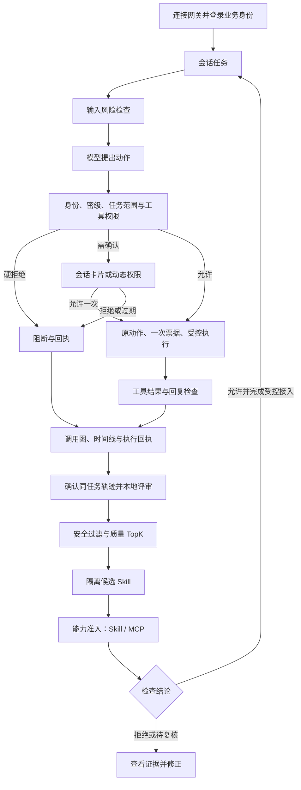

# 产品使用逻辑与模块协同

> 比赛分支说明：本文保留通用 v1.0 的机制参考；电网资料、授权角色和现场步骤以[当前系统](CURRENT_SYSTEM.md)及[比赛版说明](COMPETITION_DEMO.md)为准。

2026-11-10。**能力接入先检查，任务执行按身份授权，结果沿轨迹复盘，经验经评估成为候选技能。** 当前行为以[系统基准](CURRENT_SYSTEM.md)为准。

## 从登录到任务完成

用户连接网关，在会话顶部或动态权限登录业务身份。身份自动应用于同一工作区的对话，服务端决定登记资料的读取范围，不用手动绑定任务或选材。任务仍从聊天输入开始。

## 使用前：能力接入

进入 **能力准入** 检查 Skill/MCP。Aegis 做声明、静态/语义分析及适用的 Docker 试跑，Group4 做 Skill 专项检查，联合策略决定能否接入。报告、人工复核、安装是不同状态。没有代码入口的指令 Skill 不伪造动态执行证据；MCP 配置通过也不等于服务健康或所有工具行为可信。

## 使用中：身份与动作

输入检查识别攻击及内容风险，AgentGuard 检查受管动作的主体、密级、资源和任务范围。资料读取走 `gov_read_document → OPA → 动作摘要 → 一次性 HMAC 票据 → 隔离适配器 → 审计`，模型不能指定权限。

确认卡片提供“允许一次／拒绝”，动态权限待审批区显示同一请求。演示聊天支持本人确认，最高演示账号保留宿主原生确认；D004/D005 硬拒绝不能审批绕过。最后应查看执行回执，不能只看已批准。

原生 exec/文件工具受会话 Docker/srt 与任务 ACL 约束，独立 MCP、网关和模型 API 不自动进入会话容器。工具返回和回复按实际 enforce/observe 模式处理，观察不能解释为已阻断。

## 使用后：审计与经验

**查看过程**跟踪当前运行，**演进审计**查看列表、历史与同任务比较。横向调用图和毫秒时间线来自同一 JSONL；明确父事件关联与仅时间顺序连接分别展示。BLOCK 是否实际阻断要结合执行标记及回执。

未评审显示“尚未评估”。用户确认同一 task_key 后，用 Ollama/启发式本地评审，先安全过滤再按 Q 取 TopK，保留比例 0.9。至少两条可选来源才能生成候选；步骤记录 trace_id/event_hash，候选进入隔离工坊再走 Aegis+Group4。admission_passed 不等于发布，测试来源候选不能直接生产发布。

## 管理员入口

**安全总览**集中展示统计和实际防护状态；**防护设置**只保留配置与维护，包括沙箱和演示身份源。准入规则在能力准入，外部 API 用 Configure-Model.cmd 配置。维护页面不是日常任务必经步骤。

[演示手册](PRODUCT_DEMO_RUNBOOK.md) · [能力边界](ACCEPTANCE_BOUNDARIES.md) · [功能地图](FEATURE_MAP.md)。
